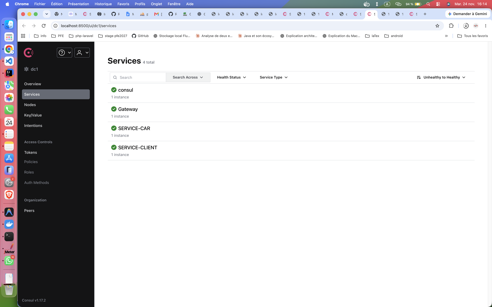
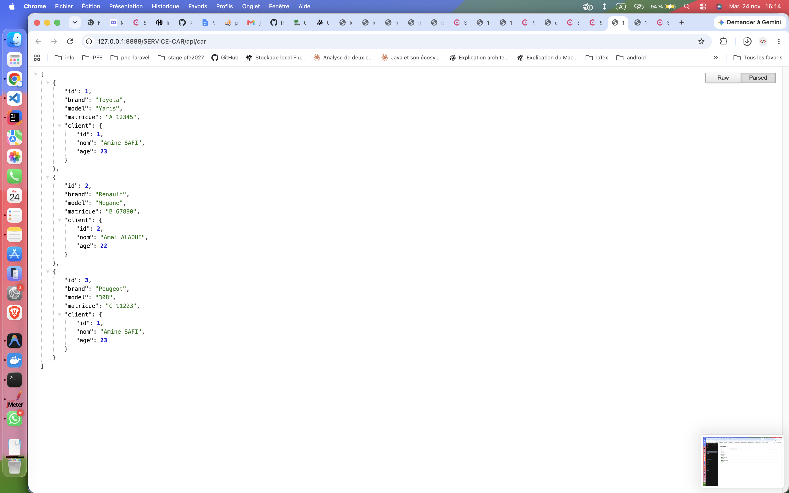
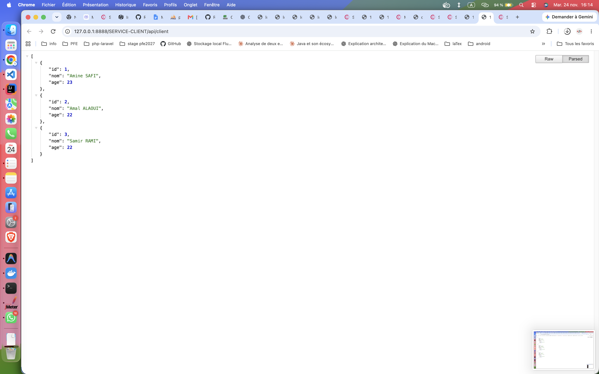

# TP 4 : Hibernate et Persistance des Données

## Description

Ce projet implémente la persistance des données avec **Hibernate ORM** et une base de données **MySQL**, en suivant une architecture en couches découplée :
- **Architecture DAO générique** : Interface `IDao<T>` définissant les opérations CRUD standards (`create`, `delete`, `update`, `getById`, `getAll`).
- **Modèle relationnel (JPA/Hibernate)** : Entités `Salle` et `Machine` liées par une association `@OneToMany` (une salle contient plusieurs machines) et `@ManyToOne` (une machine est affectée à une salle).
- **Couche Service** : `SalleService` et `MachineService` encapsulant les appels DAO et la logique métier.
- **Requêtes HQL personnalisées** : Recherche de machines par marque via Hibernate Query Language (`findByMarque`).
- **Validation** : Tests automatisés avec **JUnit 5** et classe principale d'exécution `MainTest`.

---

## Captures d'écran de l'exécution en terminal

### 1. Exécution des tests unitaires JUnit (`mvn test`)
Validation automatisée des opérations CRUD pour les entités `Salle` et `Machine`, avec génération automatique des tables (`hbm2ddl.auto=update`).

---

### 2. Exécution de l'application de test (`MainTest`)
Démonstration de l'insertion en cascade, de la récupération des données (`getAll`) et de la requête HQL personnalisée.

---

### 3. Vérification de la persistance dans MySQL
Vérification des tables `salles` et `machines` générées et alimentées avec les clés étrangères associées.

# TP 23 : Migration de Eureka vers Consul

Ce projet démontre la migration complète d'une architecture microservices basée sur Spring Cloud de **Netflix Eureka** vers **HashiCorp Consul** pour la découverte et l'enregistrement de services (Service Discovery).

---

## 🏗️ Architecture du Projet

L'architecture se compose de 4 services principaux :

1. **HashiCorp Consul** (`localhost:8500`) :
    - Registre de services et agent de santé (Health Check).
    - Fournit la découverte dynamique et une interface Web de supervision.

2. **Client Service (`SERVICE-CLIENT`)** (`port 8088`) :
    - Microservice Spring Boot gérant l'entité `Client`.
    - Base de données MySQL (`clientservicedb`).
    - S'enregistre automatiquement dans Consul.

3. **Car Service (`SERVICE-CAR`)** (`port 8082`) :
    - Microservice Spring Boot gérant l'entité `Car`.
    - Base de données MySQL (`carservicedb`).
    - Consomme le service `SERVICE-CLIENT` via la Gateway.
    - S'enregistre automatiquement dans Consul.

4. **Spring Cloud Gateway (`Gateway`)** (`port 8888`) :
    - Passerelle d'accès unique découvrant dynamiquement les services enregistrés dans Consul via `ReactiveDiscoveryClient`.

## Captures

